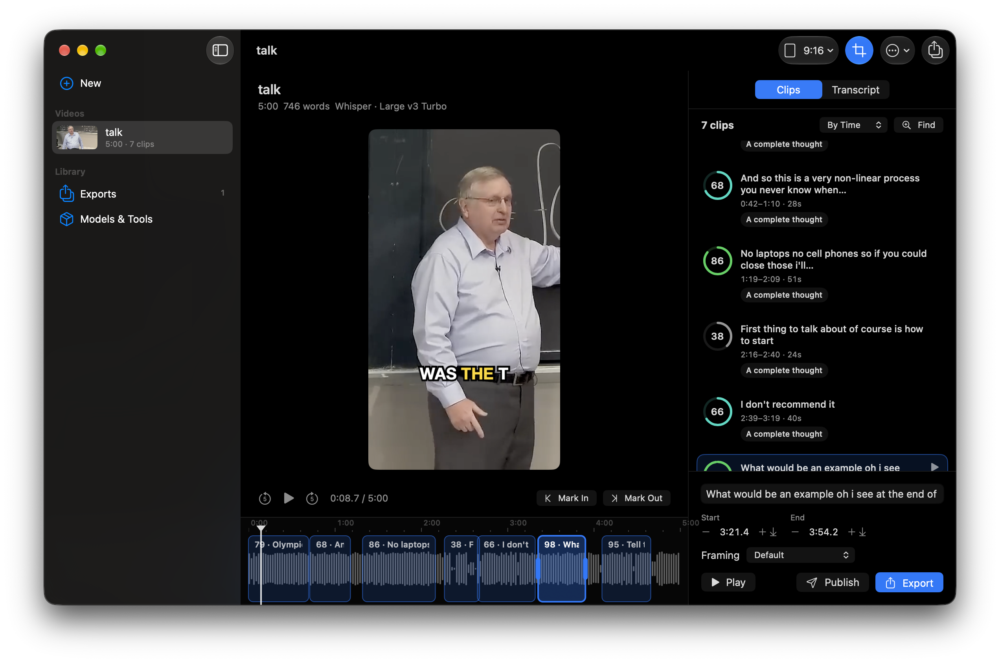

<p align="center">
  
</p>

# Hyperclip

A native macOS app that turns long videos into short, captioned clips on your Mac. An open alternative to Opus Clip, made with SwiftUI.



## What it does

- **Paste a link, get clips.** Hyperclip downloads with [yt-dlp](https://github.com/yt-dlp/yt-dlp), so YouTube, TikTok, Instagram, X, Twitch and over a thousand other sites work. It can download only part of a long stream. You can also drop in a file of your own. Videos the Mac can't play are converted with FFmpeg.
- **Signs in as you.** For age-restricted, members-only or private videos, or when YouTube asks you to prove you're not a bot, Hyperclip uses the cookies from your browser: Safari, Chrome, Arc, Brave, Edge, Helium, Firefox, Zen and more, with a choice of profile. Hyperclip decrypts cookies itself for browsers yt-dlp can't read, like Arc. A cookies.txt file works too, and **Test** checks that everything is in place before a download needs it.
- **Transcribes on your Mac.** You can use Apple's built-in on-device transcriber (nothing to install), or [Whisper](https://github.com/ggml-org/whisper.cpp) models on the GPU (detects the language, handles jargon). Any OpenAI-compatible server works too (OpenAI, Groq, Speaches, a Hypervoice server). Every word is timed.
- **Finds the clips worth posting**, in one of three ways:
  - **Built-in (no AI).** Scores every span of whole sentences on its hook, its payoff, the pace and loudness of the delivery, and its length. Instant and offline.
  - **Decision model.** Shortlists with the built-in scores, then asks a [Jev-compatible](https://docs.typesafe.ai) decision model typed questions about each clip: how strong the hook is, whether it stands on its own, how good the payoff is, and whether people would share it. It then weighs the probabilities into a score. This works with TypeSafe's Jev or with open models you host yourself (Laya, Von, Kev, AnyJev).
  - **Language model.** Reads the whole transcript and picks moments with titles, like an editor would. This works with Ollama or LM Studio on your Mac, or with any OpenAI-compatible API.
- **Clip by hand.** Press **I** and **O** while the video plays, select words in the transcript, or drag a clip's edges on the timeline. Click any word to jump to it.
- **Frames the speaker.** Vision tracks faces and crops to 9:16, 4:5 or 1:1. The crop holds still and only moves when the speaker does, the way a camera operator would. The preview shows the crop as it will export.
- **Burns in captions** word by word. Start from a style (Bold, Clean, Boxed, One word, Highlight box), then change any part of it: font, weight, size, text color, how the word being said stands out (its color, or a box behind it), outline thickness and color, shadow, a background box with its color and opacity, words per line, capitals, punctuation, position and the pop-in animation. The preview draws exactly what the export does.
- **Publishes** to X, YouTube, TikTok, Instagram, LinkedIn, Facebook, Threads, Bluesky and more through [Zernio](https://zernio.com), now or on a schedule.

## Installation

```sh
curl -fsSL https://raw.githubusercontent.com/alexisbcz/hyperclip/main/install.sh | bash
```

This builds Hyperclip from source and installs it in Applications. It needs a Mac with Apple silicon, macOS 26 or later, and Xcode. If Homebrew is installed, the script also installs yt-dlp, FFmpeg and whisper.cpp. Otherwise, install them later from **Models & Tools** in the app.

## Automation

Everything in the window can also be driven from outside. The app does the work, so whatever a script or an agent starts shows in the window as it happens.

### The `hyperclip` command

The install script links it, or use **Hyperclip › Install ‘hyperclip’ Command in PATH**. The command starts Hyperclip in the background if it isn't open.

```sh
hyperclip import https://www.youtube.com/watch?v=… --wait     # download, transcribe, find clips
hyperclip clips latest                                         # numbered, scored, timed
hyperclip transcript latest --from 12:00 --to 14:00            # what's said, with times
hyperclip clip add latest 12:04 12:41 --title "The one thing"  # cut your own
hyperclip export latest --best 3 --aspect vertical --captions bold --wait
hyperclip publish latest --to youtube,tiktok --caption "…" --tiktok-consent
hyperclip settings set captionHighlight "#34C759"             # any setting, by name
```

Add `--json` to any command to get output a script can read. Run `hyperclip --help` to see every command.

### AI agents (MCP)

`hyperclip mcp` is a Model Context Protocol server. Add it to Claude Code, Claude Desktop, Codex, Cursor, Gemini CLI, VS Code and others in one click under **Settings › Agents**, or by hand:

```json
{ "mcpServers": { "hyperclip": { "command": "hyperclip", "args": ["mcp"] } } }
```

Agents get 21 tools, including `import_video`, `get_transcript`, `find_clips`, `list_clips`, `add_clip`, `update_clip`, `export_clips`, `publish`, `get_settings` and `set_setting`. Try asking: *"Import this video, find the five best moments about pricing, export them vertical with clean captions."*

### Links and Shortcuts

- **Links:** `hyperclip://<method>?…` runs any request, for example `hyperclip://import?url=…`, `hyperclip://find?project=latest&count=5` or `hyperclip://show?project=latest&clip=2`.
- **Shortcuts:** the app adds **Clip a Video**, **Export the Best Clips** and **Get Clips** actions.

### The socket

The app listens on `~/Library/Application Support/Hyperclip/control.sock`, which only your user can open. It takes one JSON request per line, such as `{"method": "getProject", "params": {"project": "latest"}}`, and answers with `{"ok": true, "result": …}`. The methods are listed in [`Shared/Control.swift`](Shared/Control.swift). `hyperclip api <method> '<json>'` sends one from the terminal.

## Keyboard shortcuts

| Key | Action |
|---|---|
| Space | Play or pause |
| I / O | Mark in and out; marking out makes the clip |
| ← → (⇧ for 5 s) | Step 1 second |
| J / K / L | Back 10 s, pause, forward 10 s |
| , / . | Step one frame |
| Return | Play the selected clip |
| ⌘E / ⇧⌘E | Export the selected clip / every clip |
| ⌘K | Find clips again |

[MIT License](LICENSE)
